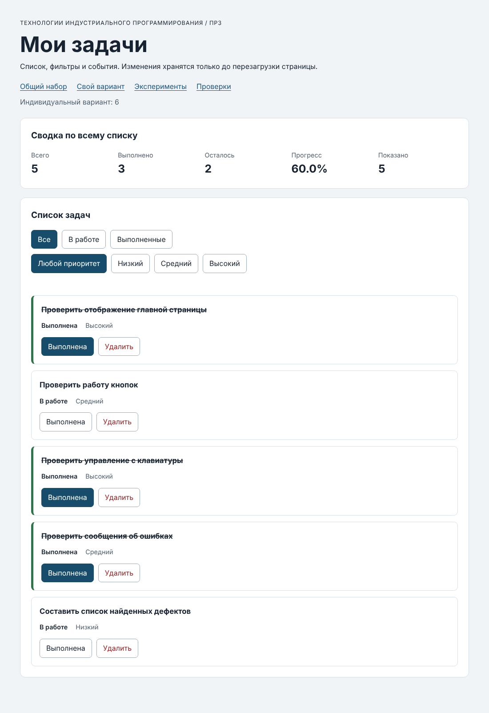

# Практическая работа № 3. Работа с DOM и событиями

## Данные работы

**Имя:** _Фамилия Имя_  
**Группа:** _Группа_  
**Вариант:** 6 — «Проверка пользовательского интерфейса»  
**ОС:** _заполнить_  
**Node.js / npm:** _заполнить_  
**Браузер:** _заполнить_

## Запуск

Из папки `practice-03`:

```bash
npm run check:service   # 35 проверок функций ПР2 в Node.js
npm start               # локальный сервер http://127.0.0.1:5503/
```

Без npm (из папки `practice-03`): `node checks/service.checks.js`, `node tools/serve.mjs`.

После запуска сервера открыть в браузере:

| Страница | Адрес |
|---|---|
| Приложение, общий набор | http://127.0.0.1:5503/ |
| Приложение, свой вариант | http://127.0.0.1:5503/index.html?dataset=variant |
| Эксперименты | http://127.0.0.1:5503/examples/dom-events.html |
| Браузерные проверки | http://127.0.0.1:5503/checks.html |

Открывать `index.html` двойным щелчком (`file://`) нельзя: страница подключает ES-модуль (`type="module"`), а браузер загружает модули только по HTTP. Сервер остаётся запущенным; остановка — `Ctrl+C`.

## Что перенесено из ПР2

`src/task-service.js` и `src/data.js` скопированы из ПР2 без изменений (вариант 6 уже заполнен). `main.js` из ПР2 не переносился: там был консольный сценарий. В `task-service.js` нет обращений к `document` — модуль по-прежнему проверяется в Node.js (35/35).

## Эксперименты

| № | Прогноз | Фактический результат | Объяснение |
|---:|---|---|---|
| 1 | `null` и `0` | `Отсутствующий элемент: null`, `Пустая коллекция: 0` | `querySelector` без совпадений возвращает `null` — обращение `null.textContent` вызовет TypeError. `querySelectorAll` всегда возвращает `NodeList`, пустой имеет длину 0 и безопасен. |
| 2 | `"23"` (string), затем `23` (number) | `dataset.taskId: 23 string`, `Числовой id: 23` | Значения в `dataset` — всегда строки. Для сравнения с `id` модели (число) нужно `Number(...)`. |
| 3 | Старый `NodeList` останется 1, новый запрос — 2, затем 3 | `Старый NodeList: 1 / Новый: 2`, затем `1 / 3` | `querySelectorAll` возвращает **статический** снимок. Новые `li` в нём не появляются; нужен новый запрос. |
| 4 | Заголовок покажет текст с угловыми скобками | Заголовок: `<strong>Это текст, а не HTML</strong>`, дочерних элементов: 0 | `textContent` записывает строку как текст, HTML не разбирается, элемент `strong` не создаётся. |
| 5 | Захват на section → кнопка → всплытие на section | `1. phase=1; target=lab-label; currentTarget=lab-card`<br>`2. phase=3; target=lab-label; currentTarget=lab-button`<br>`3. phase=3; target=lab-label; currentTarget=lab-card` | `target` всегда исходный `span#lab-label`. `currentTarget` — элемент, чей обработчик сейчас работает. Сначала фаза захвата (1) на контейнере, затем обработчик кнопки — для неё это уже **всплытие** (3), т.к. целью был вложенный `span`, затем всплытие до контейнера (3). |

**Точка останова в обработчике кнопки:** `event.target.id = "lab-label"`, `event.currentTarget.id = "lab-button"`, `event.eventPhase = 3`.

**Почему обработчик контейнера получает нажатие на вложенный элемент:** событие `click` после цели всплывает по всем предкам. Поэтому один обработчик на `ul#task-list` получает клики по любым кнопкам внутри карточек — это и есть делегирование.

## Организация кода

| Файл | Ответственность |
|---|---|
| `src/data.js` | Общий набор и вариант 6. |
| `src/task-service.js` | Функции ПР2 (`findTaskById`, `setTaskCompleted`, `removeTask`, `getTaskStats` и др.). Без DOM. |
| `src/task-selectors.js` | `getVisibleTasks(tasks, filter)` — новый массив по фильтру `all / pending / completed`; расширение: `filterByPriority(tasks, priority)`. |
| `src/task-view.js` | `createTaskElement`, `renderTaskList`, `renderSummary`, `renderEmptyState` — только создание и обновление DOM, без изменения данных и без подписок. |
| `src/main.js` | Состояние (`currentTasks`, `currentFilter`, `currentPriority`), `renderApp`, обработчики `handleTaskListClick`, `handleFilterClick`, `handlePriorityFilterClick`. |

**Ключевые решения:**

- Карточка собирается через `createElement` / `append`, все тексты — через `textContent`. `innerHTML` не используется.
- `renderTaskList` вызывает `listElement.replaceChildren(...cards)`: старые карточки заменяются, сам `ul` (и его обработчик) остаётся.
- Подписки назначаются **один раз** при загрузке, а не в `renderApp`, поэтому после перерисовок одно нажатие даёт одно изменение.
- `currentTasks` — всегда полный массив. Видимая выборка вычисляется заново в `renderApp` и никуда не сохраняется, поэтому фильтр «Все» возвращает скрытые задачи.
- Путь события: `click` → `closest("button[data-action]")` → `toggle/delete` → `closest("li[data-task-id]")` → `Number(dataset.taskId)` → проверка `Number.isSafeInteger(id) && id > 0` → функция ПР2 → `result.ok ?` → `currentTasks = result.tasks` → `renderApp()` → `restoreTaskFocus`.
- Для `toggle` текущий статус берётся из массива (`findTaskById`), а не из текста кнопки или CSS-класса.
- `Number("4abc")` → `NaN`, поэтому такой id отклоняется (в отличие от `parseInt("4abc") === 4`).

## Общий сценарий

| Шаг | Действие | Ожидание: видимые id / всего / вып. / ост. / % | Фактический результат | Итог |
|---:|---|---|---|---|
| 0 | Исходный, «Все» | `[1,4,7,10]` / 4 / 2 / 2 / 50.0% | `[1,4,7,10]` / 4 / 2 / 2 / 50.0%, показано 4 | Пройдено |
| 1 | «В работе» | `[4,7]` / 4 / 2 / 2 / 50.0% | `[4,7]` / 4 / 2 / 2 / 50.0%, показано 2 | Пройдено |
| 2 | Выполнить id 4 | `[7]` / 4 / 3 / 1 / 75.0% | `[7]` / 4 / 3 / 1 / 75.0%, показано 1 | Пройдено |
| 3 | «Все» | `[1,4,7,10]` / 4 / 3 / 1 / 75.0% | Совпало, показано 4 | Пройдено |
| 4 | Удалить id 7 | `[1,4,10]` / 3 / 3 / 0 / 100.0% | Совпало, показано 3 | Пройдено |
| 5 | «В работе» | `[]` / 3 / 3 / 0 / 100.0% | `[]`, показано 0, «Нет задач по выбранному фильтру.» | Пройдено |
| 6 | «Все», переключить id 1 | `[1,4,10]` / 3 / 2 / 1 / 66.7% | Совпало, показано 3 | Пройдено |
| 7 | Удалить 1, 4, 10 | `[]` / 0 / 0 / 0 / 0.0% | `[]`, 0.0%, «Список задач пуст.» | Пройдено |
| — | Перезагрузка | Возврат к шагу 0 | `[1,4,7,10]` / 4 / 2 / 2 / 50.0% | Пройдено |

## Индивидуальный вариант

Адрес `index.html?dataset=variant`, метка «Индивидуальный вариант: 6».

| Шаг | Ожидание: видимые / всего / вып. / % | Фактический результат | Итог |
|---|---|---|---|
| Исходный, «Все» | `[11,23,37,41,58,64]` / 6 / 5 / 83.3% | Совпало | Пройдено |
| «В работе» | `[64]`, показано 1 | `[64]`, 83.3% | Пройдено |
| «Выполненные» | `[11,23,37,41,58]`, показано 5 | Совпало | Пройдено |
| «Все», переключить id 23 | 6 / 4 / 66.7% | 6 / 4 / 2 / 66.7% | Пройдено |
| Удалить id 37 | `[11,23,41,58,64]` / 5 / 3 / **60.0%** (по таблице методички) | `[11,23,41,58,64]` / 5 / 3 / 2 / 60.0% | Пройдено |
| «В работе» / «Выполненные» | `[23,64]` / `[11,41,58]` | Совпало | Пройдено |

Названия и приоритеты остальных записей сохранились (id 11 — Высокий, 23 — Средний, 41 — Высокий, 58 — Средний, 64 — Низкий).

## Протокол проверки сервиса

```text
$ npm run check:service
...
OK: 35. Работа с другим набором, без зависимости от demoTasks

Проверок пройдено: 35; не пройдено: 0.
```

## Протокол браузерных проверок

Текст из блока «Текстовый протокол» страницы `checks.html`:

```text
OK: Фильтр all возвращает новый массив в исходном порядке
OK: Фильтр pending выбирает невыполненные задачи
OK: Фильтр completed выбирает выполненные задачи
OK: Все три фильтра работают с пустым списком
OK: Фильтрация не меняет входные записи и их порядок
OK: Карточка — li.task-card с числовым id в dataset
OK: Статус невыполненной карточки и aria-pressed согласованы
OK: Статус выполненной карточки и aria-pressed согласованы
OK: В карточке две обычные кнопки с вложенными подписями
OK: Все приоритеты отображаются по установленному словарю
OK: Название с разметкой отображается текстом
OK: Отрисовка списка создаёт карточки в исходном порядке
OK: Повторная отрисовка не накапливает карточки
OK: Контейнер списка и его обработчик сохраняются
OK: Отрисовка пустого массива очищает прежние карточки
OK: Сводка считается по всему списку, отдельно выводится Показано
OK: Пустая сводка не содержит NaN и Infinity
OK: Сообщение для полностью пустого списка
OK: Сообщение для пустого результата фильтра
OK: Появление карточек скрывает прежнее пустое состояние
OK: Приложение: начальный набор и сводка
OK: Приложение: фильтр срабатывает по клику на вложенный span
OK: Приложение: активный фильтр отмечен классом и aria-pressed
OK: Приложение: фильтрация не удаляет скрытые задачи
OK: Приложение: переключение по id, а не индексу массива
OK: Приложение: выполненная задача исчезает из фильтра В работе
OK: Приложение: удаление изменяет данные, а не только DOM
OK: Приложение: клик по названию не изменяет данные
OK: Приложение: после перерисовок одно нажатие — одно изменение
OK: Приложение: удаление всех записей и нулевая сводка
OK: Приложение: нет совпадений — не то же самое, что нет задач
OK: Приложение: неизвестный числовой id не меняет данные
OK: Приложение: id 4abc не превращается в 4
OK: Приложение: неизвестное действие игнорируется
OK: Приложение: после изменения сохраняется клавиатурный фокус
OK: Приложение: новая загрузка возвращает исходное состояние

Всего: 36. Пройдено: 36. Ошибок: 0.
```

## Собственные проверки

| Проверка | Исходное состояние и действие | Ожидание | Фактический результат | Итог |
|---|---|---|---|---|
| С1. Быстрые переключения (событие) | Общий набор, 5 нажатий «Выполнена» у id 10 подряд | Нечётное число → id 10 стала невыполненной: 4 / 1 / 3 / 25.0% | 4 / 1 / 3 / 25.0% | Пройдено |
| С2. Действие после смены фильтров (перерисовка) | «В работе» → «Выполненные» → «Все», затем выполнить id 4, затем «Выполненные» | Одно изменение; видимые `[1, 4]`, 50.0% | `[1, 4]`, 2 / 2 / 50.0% | Пройдено |
| С3. Название длиной 100 (граница) | `createTaskElement` с названием из 100 символов | В `.task-title` ровно 100 символов | 100 | Пройдено |
| С4. Единственная выполненная задача (граница) | Список из одной задачи `completed: true`; фильтр «В работе» | Одна карточка; сводка 1/1/0/100.0%; `pending` даёт `[]` | 1 карточка; «1 / 1 / 0 / 100.0% / 0»; 0 | Пройдено |
| С5. Экспортируемый набор не меняется | После всех действий в приложении прочитать `demoTasks` из модуля | Статусы `[1:true, 4:false, 7:false, 10:true]` | Совпало | Пройдено |

## Отладка и клавиатура

**Точка останова на строке `const rawId = card.dataset.taskId` в `handleTaskListClick`** (нажатие на подпись «Выполнена» у id 4):

- `rawId = "4"`, `typeof rawId = "string"` — строка из `dataset`;
- `action = "toggle"`;
- `event.target` — `span.action-label`, `event.currentTarget` — `ul#task-list` (делегирование);
- после `Number`: `id = 4` (number), найденная запись `{ id: 4, title: "Подготовить модель задач", completed: false, priority: "high" }`.

**Вторая остановка** (строка `currentTasks = result.tasks`): `result.ok = true`, в `result.tasks` у id 4 `completed: true`, `result.tasks === currentTasks` → `false` (новый массив, старый не изменён).

**Проверка отказа через Elements:**

- `data-task-id` = `777`, «Удалить» → сообщение «Ошибка: Задача с id 777 не найдена», сводка 4 / 2 / 2 / 50.0% без изменений. Выбор «Все» пересоздал карточки из массива (снова id 4) и очистил сообщение.
- `data-task-id` = `4abc`, «Выполнена» → «Ошибка: некорректный идентификатор задачи «4abc»», данные не изменились.

**Клавиатура:** фокус на «Выполнена» id 4, `Enter` → задача выполнена (75.0%), фокус вернулся на ту же кнопку той же карточки; `Space` → обратно 50.0%; `Tab` → «Удалить» той же карточки; `Enter` → карточка удалена, фокус перешёл на активный фильтр «Все».

_Скриншот точки останова в DevTools — по желанию сделать самостоятельно._

## Вид приложения

Свой вариант после сценария (5 задач, 60.0%):



## Дополнительное задание

**Вариант А. Фильтр по приоритету.** Отдельная группа кнопок `#priority-filters` (Любой / Низкий / Средний / Высокий) под основными фильтрами; три основные кнопки остались в `#task-filters` без изменений. Фильтры применяются совместно: в `renderApp` сначала `getVisibleTasks` (статус), затем к результату `filterByPriority` (приоритет). Сводка по-прежнему по полному массиву, «Показано» — по совместной выборке. Обработчик назначен один раз, неизвестное значение `data-priority` игнорируется.

| Проверка | Действие | Ожидание | Фактический результат | Итог |
|---|---|---|---|---|
| Р1. Совместный фильтр | «В работе» + «Высокий» | Только `[4]`; сводка 4/2/2/50.0%, показано 1 | `[4]`, показано 1 | Пройдено |
| Р2. Нет совпадений | «В работе» + «Средний» | `[]`, «Нет задач по выбранному фильтру.» | Совпало | Пройдено |
| Р3. Выбор сохраняется после действия | «Выполненные» + «Средний», выполнить→снять id 1 | Видимые `[10]`; активны `completed` и `medium` | `[10]`; активны completed, medium | Пройдено |
| Р4. Возврат в исходное | «Все» + «Любой приоритет» | `[1, 4, 7, 10]` | Совпало | Пройдено |
| Р5. Удаление под фильтром | «Низкий», удалить id 7 | `[]`, всего 3, 33.3% | `[]`, 3 / 1 / 2 / 33.3% | Пройдено |

Все 36 обязательных проверок проходят и с расширением.

## Вывод

Освоена связка «данные → выборка → DOM»: полный массив задач хранится отдельно от фильтра, видимая часть вычисляется при каждой отрисовке, а изменения идут только через функции ПР2. Делегирование с `closest` позволяет обрабатывать клики по любым (в том числе вложенным) элементам карточек одним обработчиком, который не теряется при пересоздании карточек. Важные границы: идентификатор из `dataset` — строка и проверяется через `Number` + `isSafeInteger`, текст выводится только через `textContent`, при отказе операции состояние не меняется.
